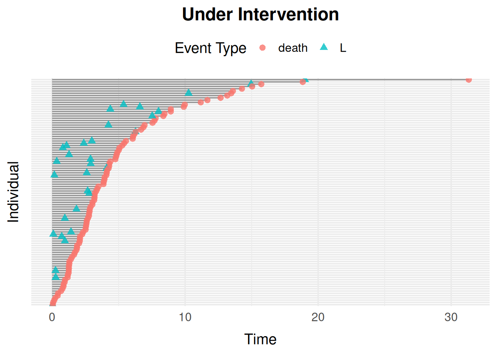

# Simulating Event History Data

``` r

library(simevent)
library(survival)
```

## Introduction

simevent simulates event history data in two steps:
[`sim_model()`](https://github.com/BjarkeHautop/simevent/reference/sim_model.md)
describes baseline covariates, event processes and the Cox-type effects
between them, and
[`sim_events()`](https://github.com/BjarkeHautop/simevent/reference/sim_events.md)
simulates individuals from it. This vignette introduces the model
interface, shows how to simulate and evaluate interventions with
[`event_risk()`](https://github.com/BjarkeHautop/simevent/reference/event_risk.md),
and how to build a model from Cox models fitted to observed data with
[`sim_model_from_fits()`](https://github.com/BjarkeHautop/simevent/reference/sim_model_from_fits.md).
Time-varying markers and effects of event history are covered in more
depth in
[`vignette("event-times-and-markers")`](https://github.com/BjarkeHautop/simevent/articles/event-times-and-markers.md).

## The `sim_model()` Interface

A
[`sim_model()`](https://github.com/BjarkeHautop/simevent/reference/sim_model.md)
call has three kinds of possible inputs:

- [`sim_covariate()`](https://github.com/BjarkeHautop/simevent/reference/sim_covariate.md):
  a baseline covariate generator. Takes `N` and, optionally, any other
  covariate defined earlier in the same call (matched by argument name).
- [`sim_process()`](https://github.com/BjarkeHautop/simevent/reference/sim_process.md):
  a `"censoring"`, `"terminal"`, or `"transient"` (fires at most `limit`
  times, default `Inf`) process, with Weibull `eta`/`nu` parameters or a
  given cumulative baseline hazard curve (`cumhaz`).
- [`sim_effect()`](https://github.com/BjarkeHautop/simevent/reference/sim_effect.md):
  a `to ~ from` edge with a Cox-type `coef`, where `from` is a covariate
  or process name and `to` is a process name. Several terms take one
  `coef` each, as in `sim_effect(death ~ L0 + A0, coef = c(1.5, -0.5))`.

``` r

model <- sim_model(
  L0 = sim_covariate(function(N) rbinom(N, 1, 0.4)),
  censoring = sim_process("censoring", eta = 0.1, nu = 1.1),
  death = sim_process("terminal", eta = 0.1, nu = 1.1),
  effects = list(sim_effect(death ~ L0, coef = 1.5))
)
model
#> <sim_model>
#>   1 covariate(s): L0
#>   2 process(es): censoring, death
#>   1 effect(s):
#>     death ~ 1.5 * L0

data <- sim_events(model, n = 100)
head(data)
#> Key: <id>
#>       id        time     event    L0
#>    <int>       <num>    <fctr> <int>
#> 1:     1 5.754243445     death     0
#> 2:     2 0.222247849     death     1
#> 3:     3 5.103899898     death     0
#> 4:     4 1.370335546 censoring     0
#> 5:     5 0.567566882     death     0
#> 6:     6 0.002809244 censoring     1
```

[`sim_events()`](https://github.com/BjarkeHautop/simevent/reference/sim_events.md)’s
`intervene` argument takes a named list: give a process name to scale
its `eta`, or a covariate name to fix it to a constant.

``` r

data_intervened <- sim_events(
  model,
  n = 100,
  intervene = list(death = 0.2, L0 = 1)
)
head(data_intervened)
#> Key: <id>
#>       id      time     event    L0
#>    <int>     <num>    <fctr> <num>
#> 1:     1 0.1203153 censoring     1
#> 2:     2 0.6737020 censoring     1
#> 3:     3 0.1258056     death     1
#> 4:     4 2.5491181 censoring     1
#> 5:     5 2.5120989     death     1
#> 6:     6 1.4579285 censoring     1
```

### Non-Linear and History-Dependent Effects

The right-hand side of a
[`sim_effect()`](https://github.com/BjarkeHautop/simevent/reference/sim_effect.md)
formula doesn’t have to name a single covariate or process. It can be
any R expression of the covariate/process values plus the current time
`t`, the event times `event_time(proc, k)` (time of `proc`’s `k`-th
event, or `k`-th latest if `k` is negative, `0` if it hasn’t happened
yet) and node values at earlier times, such as
`bp(event_time(visit, -1))`. Covers thresholds, interactions, and
nonlinear transforms inline, and effects depending on a process’s full
occurrence history, not just its current count, without a separate
[`sim_derived()`](https://github.com/BjarkeHautop/simevent/reference/sim_derived.md)
covariate.

For example, an effect that only fires on a process’s 3rd occurrence,
not the 1st or 2nd:

``` r

relapse_model <- sim_model(
  censoring = sim_process("censoring", eta = 0.01, nu = 1),
  relapse = sim_process("transient", eta = 0.3, nu = 1, limit = 5),
  death = sim_process("terminal", eta = 0.01, nu = 1),
  effects = list(
    sim_effect(death ~ relapse == 3, coef = 8)
  )
)

set.seed(1405)
relapse_data <- sim_events(relapse_model, n = 2000, max_events = 40)

deaths <- relapse_data[relapse_data$event == "death", ]
mean(deaths$relapse == 3)
#> [1] 0.893956
```

Most deaths happen right at the 3rd relapse, not before or after.

[`event_time()`](https://github.com/BjarkeHautop/simevent/reference/event_time.md)
gives access to timing, not just counts. `event_time(proc, k)` is the
time of `proc`’s `k`-th event, and `0` if it hasn’t happened yet.
Effects on time since an event therefore take the form
`proc * f(t - event_time(proc, k))`: multiplying by the event count
switches the effect off until the event has happened, whatever `f` is.

Here the death hazard spikes right after an operation and then fades:

``` r

operation_model <- sim_model(
  censoring = sim_process("censoring", eta = 0.05, nu = 1),
  operation = sim_process("transient", eta = 0.2, nu = 1, limit = 1),
  death = sim_process("terminal", eta = 0.02, nu = 1),
  effects = list(
    sim_effect(
      death ~ operation * exp(-(t - event_time(operation, 1))),
      coef = 3
    )
  )
)

operation_data <- sim_events(operation_model, n = 2000)
head(operation_data)
#> Key: <id>
#>       id       time     event operation
#>    <int>      <num>    <fctr>     <num>
#> 1:     1  4.8162058 operation         1
#> 2:     1 19.2543737     death         1
#> 3:     2  2.0629123 operation         1
#> 4:     2  2.4574322     death         1
#> 5:     3  0.5061987 operation         1
#> 6:     3 20.3693092 censoring         1
```

Without the `operation *`, the not-yet-operated would have
`exp(-(t - 0)) = exp(-t)`, a spike at time 0 that never happened. For a
risk that instead builds up after the operation, use
`operation * (t - event_time(operation, 1))`.

A negative `k` counts back from the latest event. Here the death hazard
drops for one time unit right after each checkup:

``` r

checkup_model <- sim_model(
  censoring = sim_process("censoring", eta = 0.05, nu = 1.1),
  checkup = sim_process("transient", eta = 0.3, nu = 1),
  death = sim_process("terminal", eta = 0.05, nu = 1.1),
  effects = list(
    sim_effect(
      death ~ checkup > 0 & t - event_time(checkup, -1) < 1,
      coef = -2
    )
  )
)

checkup_data <- sim_events(checkup_model, n = 2000)
head(checkup_data)
#> Key: <id>
#>       id       time     event checkup
#>    <int>      <num>    <fctr>   <num>
#> 1:     1  3.6908384   checkup       1
#> 2:     1 13.3649425   checkup       2
#> 3:     1 13.5615104 censoring       2
#> 4:     2  0.9333917   checkup       1
#> 5:     2  7.2505068   checkup       2
#> 6:     2 14.4228692   checkup       3
```

The `checkup > 0 &` keeps the effect off before the first checkup, when
`event_time(checkup, -1)` is `0`.

## Estimating Intervention Effects

The effect of an intervention on a process is estimated in two steps,
which work for any process in any model:

1.  Simulate with and without the intervention, using
    [`sim_events()`](https://github.com/BjarkeHautop/simevent/reference/sim_events.md)’s
    `intervene` argument: `intervene = list(<process> = alpha)`
    multiplies that process’s `eta` by `alpha`.
2.  Summarise each run with
    [`event_risk()`](https://github.com/BjarkeHautop/simevent/reference/event_risk.md):
    the risk P(T \le \tau) of each process’s first event, or
    (`type = "time_lost"`) the expected time lost to it before \tau,
    E\[\tau - \min(T, \tau)\].

Take a model where a disease process `L` raises the death hazard, and
consider halving the hazard of disease:

``` r

disease_model <- sim_model(
  L0 = sim_covariate(function(N) runif(N)),
  A0 = sim_covariate(function(N, L0) rbinom(N, 1, 0.5)),
  censoring = sim_process("censoring", eta = 0.1, nu = 1.1),
  death = sim_process("terminal", eta = 0.1, nu = 1.1),
  L = sim_process("transient", eta = 0.1, nu = 1.1, limit = 1),
  effects = list(
    sim_effect(death ~ L0, 1),
    sim_effect(L ~ L0, 1),
    sim_effect(death ~ L, 1)
  )
)
```

Censoring before \tau biases
[`event_risk()`](https://github.com/BjarkeHautop/simevent/reference/event_risk.md)’s
estimates, so switch it off with `cens = 0`. Simulating both with and
without the intervention gives the effect directly:

``` r

set.seed(1405)
observed <- sim_events(disease_model, n = 5000, cens = 0)
intervened <- sim_events(
  disease_model,
  n = 5000,
  cens = 0,
  intervene = list(L = 0.5)
)

risk_observed <- event_risk(observed, disease_model, c("death", "L"), tau = 5)
risk_intervened <- event_risk(
  intervened,
  disease_model,
  c("death", "L"),
  tau = 5
)
cbind(
  risk_observed[, "process"],
  observed = risk_observed$risk,
  intervened = risk_intervened$risk
)
#>    process observed intervened
#>     <char>    <num>      <num>
#> 1:   death   0.7536     0.7048
#> 2:       L   0.4240     0.2522
```

Halving the disease hazard lowers the risk of disease, and, since
disease raises the death hazard (`sim_effect(death ~ L, 1)`), the risk
of death too.

`type = "time_lost"` gives the years lost instead, and `by` summarises
within groups of baseline covariates:

``` r

event_risk(
  intervened,
  disease_model,
  c("death", "L"),
  tau = 5,
  type = "time_lost",
  by = "A0"
)
#>       A0 process time_lost
#>    <int>  <char>     <num>
#> 1:     0   death 1.9576333
#> 2:     1   death 1.9396741
#> 3:     0       L 0.7580466
#> 4:     1       L 0.7724950
```

`by` conditions on the observed value of `A0`. It only takes baseline
columns; for a
[`sim_mark()`](https://github.com/BjarkeHautop/simevent/reference/sim_mark.md),
group by its baseline value `<mark>_0`. For a `do()`-style contrast,
where everyone’s `A0` is set to a value, fix it with `intervene`
instead, e.g. `intervene = list(L = 0.5, A0 = 1)`.

[`plot_event_data()`](https://github.com/BjarkeHautop/simevent/reference/plot_event_data.md)
shows the individual event histories under the intervention:

``` r

plot_event_data(
  intervened[intervened$id <= 100, ],
  title = "Under Intervention"
)
```



### Calibrating a Coefficient to a Target Effect

Hitting a specific target effect by hand means repeating the comparison
above many times: a 1-D search. Risk is monotonic in a Cox-type
coefficient, so [`uniroot()`](https://rdrr.io/r/stats/uniroot.html)
finds it directly from a function returning the simulated effect for a
given coefficient.

Use the same `n`/`tau` on every call, and the same random seed for the
natural and intervened runs (common random numbers), so only the
coefficient and the intervention vary, not independent Monte Carlo noise
too. Otherwise the search target is too noisy for
[`uniroot()`](https://rdrr.io/r/stats/uniroot.html) to bracket a root.

Take `disease_model` from above, but suppose disease’s effect on death
(fixed at `1` there) is unknown, and the target is: halving the disease
hazard should lower 5-year death risk by 5 percentage points.

``` r

disease_effect_on_death <- function(coef, n = 3000, tau = 5, seed = 1) {
  model <- sim_model(
    L0 = sim_covariate(function(N) runif(N)),
    A0 = sim_covariate(function(N, L0) rbinom(N, 1, 0.5)),
    censoring = sim_process("censoring", eta = 0.1, nu = 1.1),
    death = sim_process("terminal", eta = 0.1, nu = 1.1),
    L = sim_process("transient", eta = 0.1, nu = 1.1, limit = 1),
    effects = list(
      sim_effect(death ~ L0, 1),
      sim_effect(L ~ L0, 1),
      sim_effect(death ~ L, coef)
    )
  )

  set.seed(seed)
  natural <- sim_events(model, n = n, cens = 0)
  set.seed(seed)
  intervened <- sim_events(
    model,
    n = n,
    cens = 0,
    intervene = list(L = 0.5)
  )

  risk_natural <- event_risk(natural, model, "death", tau = tau)$risk
  risk_intervened <- event_risk(intervened, model, "death", tau = tau)$risk
  risk_natural - risk_intervened
}
```

Larger coefficients make disease matter more for death, so halving its
hazard lowers death risk by more: `disease_effect_on_death()` is
increasing in `coef`.

``` r

sapply(c(0, 1, 2, 3), disease_effect_on_death)
#> [1] -0.003666667  0.046666667  0.077333333  0.086000000
```

[`uniroot()`](https://rdrr.io/r/stats/uniroot.html) finds the
coefficient giving a 5 percentage point reduction:

``` r

calibrated <- uniroot(
  function(coef) disease_effect_on_death(coef) - 0.05,
  interval = c(0, 3),
  tol = 0.01
)
calibrated$root
#> [1] 1.085581
```

For several coefficients and targets at once, wrap the sum of squared
deviations into one objective (still with common random numbers) and use
[`optim()`](https://rdrr.io/r/stats/optim.html) instead of
[`uniroot()`](https://rdrr.io/r/stats/uniroot.html).

## Building a `sim_model()` from Fitted Cox Models

Instead of user-specified effects,
[`sim_model_from_fits()`](https://github.com/BjarkeHautop/simevent/reference/sim_model_from_fits.md)
builds a
[`sim_model()`](https://github.com/BjarkeHautop/simevent/reference/sim_model.md)
from a set of fitted
[`coxph()`](https://rdrr.io/pkg/survival/man/coxph.html) models (one per
process) and the data they were fit to, so simulated data mimics an
observed dataset’s distribution. Baseline covariates are generated by
resampling whole rows of the data, keeping each covariate’s distribution
and the relationships between them.

``` r

# Some "observed" data, from a 3-cause competing-risks sim_model():
set.seed(1405)
observed_model <- sim_model(
  L0 = sim_covariate(function(N) runif(N)),
  A0 = sim_covariate(function(N, L0) rbinom(N, 1, 0.5)),
  censoring = sim_process("censoring", eta = 0.1, nu = 1.1),
  cause1 = sim_process("terminal", eta = 0.1, nu = 1.1),
  cause2 = sim_process("terminal", eta = 0.1, nu = 1.1),
  effects = list(
    sim_effect(censoring ~ L0 + A0, coef = c(0.5, -1)),
    sim_effect(cause1 ~ L0 + A0, coef = c(-0.5, 0.5)),
    sim_effect(cause2 ~ A0, coef = 0.5)
  )
)
observed_data <- sim_events(observed_model, n = 1000)

# Refit from "observed" data, then rebuild a sim_model(), as if
# observed_model were unknown:
fits <- list(
  censoring = coxph(
    Surv(time, event == "censoring") ~ L0 + A0,
    data = observed_data
  ),
  cause1 = coxph(Surv(time, event == "cause1") ~ L0 + A0, data = observed_data),
  cause2 = coxph(Surv(time, event == "cause2") ~ L0 + A0, data = observed_data)
)
types <- c(censoring = "censoring", cause1 = "terminal", cause2 = "terminal")

model <- sim_model_from_fits(fits, observed_data, types)
model
#> <sim_model>
#>   2 covariate(s): L0, A0
#>   3 process(es): censoring, cause1, cause2
#>   6 effect(s):
#>     censoring ~ 0.4875836 * L0
#>     censoring ~ -0.9133865 * A0
#>     cause1 ~ -0.4906536 * L0
#>     cause1 ~ 0.3575318 * A0
#>     cause2 ~ 0.02845469 * L0
#>     cause2 ~ 0.6609588 * A0
```

Each process uses its
[`coxph()`](https://rdrr.io/pkg/survival/man/coxph.html) fit’s
cumulative baseline hazard as-is, so the simulated event times follow
its shape. The hazard is unknown beyond the last observed time, so
simulated follow-up ends there (`event = "max_cens"`).

``` r

new_data <- sim_events(model, n = 1000)
head(new_data)
#> Key: <id>
#>       id     time     event        L0    A0
#>    <int>    <num>    <fctr>     <num> <num>
#> 1:     1 1.620870 censoring 0.9559121     0
#> 2:     2 2.219986    cause2 0.9885974     1
#> 3:     3 2.006563    cause2 0.4766994     1
#> 4:     4 1.701406    cause1 0.1054270     0
#> 5:     5 1.036467    cause2 0.5620987     1
#> 6:     6 4.455880    cause2 0.1166055     1

# Event-type distribution should match between observed and simulated data (a
# few simulated individuals reach the end of the observed follow-up, as
# "max_cens"):
event_levels <- levels(new_data$event)
rbind(
  observed = prop.table(table(factor(observed_data$event, event_levels))),
  simulated = prop.table(table(new_data$event))
)
#>           censoring cause1 cause2 max_cens
#> observed      0.294  0.316  0.390        0
#> simulated     0.318  0.311  0.371        0
```

### Categorical Baseline Covariates

A categorical baseline covariate must be a factor column in `data`,
referenced directly in the
[`coxph()`](https://rdrr.io/pkg/survival/man/coxph.html) formula (not
wrapped in [`factor()`](https://rdrr.io/r/base/factor.html) there).
[`sim_model_from_fits()`](https://github.com/BjarkeHautop/simevent/reference/sim_model_from_fits.md)
regenerates it as its integer level codes, plus one
[`sim_derived()`](https://github.com/BjarkeHautop/simevent/reference/sim_derived.md)
dummy per non-reference level, named to match
[`coxph()`](https://rdrr.io/pkg/survival/man/coxph.html)’s own
coefficient names (`"<variable><level>"`).

``` r

observed_data$region <- factor(sample(
  c("a", "b", "c"),
  nrow(observed_data),
  replace = TRUE,
  prob = c(0.5, 0.3, 0.2)
))

fits_region <- list(
  censoring = coxph(
    Surv(time, event == "censoring") ~ L0 + region,
    data = observed_data
  ),
  cause1 = coxph(
    Surv(time, event == "cause1") ~ L0 + region,
    data = observed_data
  ),
  cause2 = coxph(Surv(time, event == "cause2") ~ L0, data = observed_data)
)

model_region <- sim_model_from_fits(fits_region, observed_data, types)
model_region
#> <sim_model>
#>   4 covariate(s): L0, region, regionb, regionc
#>   3 process(es): censoring, cause1, cause2
#>   7 effect(s):
#>     censoring ~ 0.5553192 * L0
#>     censoring ~ 0.1303675 * regionb
#>     censoring ~ -0.1039648 * regionc
#>     cause1 ~ -0.5294444 * L0
#>     cause1 ~ -0.06959473 * regionb
#>     cause1 ~ -0.2083812 * regionc
#>     cause2 ~ -0.01866116 * L0
```
