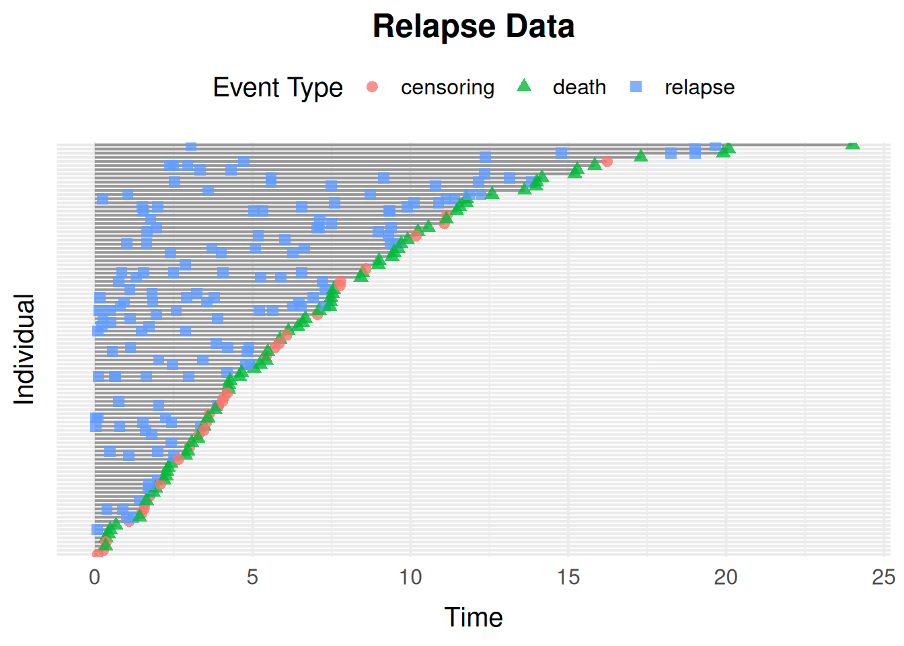

# Simulating Event History Data

``` r

library(simevent)
library(survival)
```

simevent simulates event histories from a model of covariates, event
processes and the effects between them. As a running example, we
simulate patients who may relapse and die, and then use the model to
evaluate a new drug.

## Starting Simple: Survival

Suppose we want to simulate how long patients survive, and that older
patients die sooner.
[`sim_model()`](https://github.com/BjarkeHautop/simevent/reference/sim_model.md)
describes this with an age covariate, two processes, and an effect of
age on the death hazard.
[`simulate_events()`](https://github.com/BjarkeHautop/simevent/reference/simulate_events.md)
then simulates patients from the model:

``` r

survival_model <- sim_model(
  age = sim_covariate(function(N) rnorm(N, mean = 60, sd = 10)),
  censoring = sim_process("censoring", eta = 0.05, nu = 1),
  death = sim_process("terminal", eta = 0.05, nu = 1.2),
  effects = list(sim_effect(death ~ age - 60, coef = 0.04))
)
survival_model
#> <sim_model>
#>   1 covariate(s): age
#>   2 process(es): censoring, death
#>   1 effect(s):
#>     death ~ 0.04 * (age - 60)

survival_data <- simulate_events(survival_model, n = 2000, seed = 1)
head(survival_data)
#> Key: <id>
#>       id      time     event      age
#>    <int>     <num>    <fctr>    <num>
#> 1:     1 14.378085     death 53.73546
#> 2:     2  5.446483     death 61.83643
#> 3:     3 29.861030     death 51.64371
#> 4:     4  4.005196 censoring 75.95281
#> 5:     5  0.538666     death 63.29508
#> 6:     6  9.098355 censoring 51.79532
```

Each patient is followed until death or censoring. The death hazard is

\lambda\_{\text{death}}(t) = \lambda_0(t) \exp\left( 0.04 (\text{age} -
60) \right),

where \lambda_0(t) is the baseline hazard given by `eta` and `nu`, so
each year above 60 raises the hazard by about 4%.

Baseline hazards

`eta` and `nu` are the Weibull scale and shape. To use a given curve
instead, pass a cumulative baseline hazard as `cumhaz`.

## Adding Treatment

Now suppose older patients are more likely to be treated, and treatment
lowers the death hazard. Treatment is another covariate, one that
depends on age, and [`update()`](https://rdrr.io/r/stats/update.html)
adds it to the existing model:

``` r

treatment_model <- update(
  survival_model,
  treatment = sim_covariate(function(N, age) {
    rbinom(N, 1, plogis((age - 60) / 10))
  }),
  effects = list(sim_effect(death ~ treatment, coef = -0.5))
)
treatment_model
#> <sim_model>
#>   2 covariate(s): age, treatment
#>   2 process(es): censoring, death
#>   2 effect(s):
#>     death ~ 0.04 * (age - 60)
#>     death ~ -0.5 * treatment
```

Covariates and terms

A covariate’s function takes `N` and any covariates defined earlier,
matched by argument name. `+` separates the terms of an effect, each
with its own `coef`, as in
`sim_effect(death ~ age + treatment, coef = c(0.04, -0.5))`. To give a
sum one `coef`, wrap it in parentheses.

## Adding Relapse

Patients can also relapse, possibly several times, and each relapse
raises the death hazard. Treatment makes relapse less likely. A relapse
doesn’t end follow-up, so it’s a `"transient"` process, and using its
name in an effect gives the patient’s number of relapses so far:

``` r

relapse_model <- update(
  treatment_model,
  relapse = sim_process("transient", eta = 0.3, nu = 1),
  effects = list(
    sim_effect(relapse ~ treatment, coef = -0.7),
    sim_effect(death ~ relapse, coef = 0.5)
  )
)

relapse_data <- simulate_events(relapse_model, n = 2000, seed = 1)
head(relapse_data)
#> Key: <id>
#>       id      time     event      age treatment relapse
#>    <int>     <num>    <fctr>    <num>     <int>   <num>
#> 1:     1 0.6768458     death 53.73546         0       0
#> 2:     2 1.5791459 censoring 61.83643         1       0
#> 3:     3 1.1124888   relapse 51.64371         0       1
#> 4:     3 7.2958637   relapse 51.64371         0       2
#> 5:     3 7.5696488     death 51.64371         0       2
#> 6:     4 9.0076112     death 75.95281         1       0
```

Each row is now an event, and
[`plot_event_data()`](https://github.com/BjarkeHautop/simevent/reference/plot_event_data.md)
shows the histories:

``` r

plot_event_data(relapse_data[relapse_data$id <= 100, ], title = "Relapse Data")
```



Reading the data

The `relapse` column is the count *after* each row’s event. For the
values during each interval, as needed for a Cox model, use
[`format_interval_data()`](https://github.com/BjarkeHautop/simevent/reference/format_interval_data.md).
To cap the number of relapses, use
[`sim_process()`](https://github.com/BjarkeHautop/simevent/reference/sim_process.md)’s
`limit`.

## Effects of Event History

So far every relapse adds the same amount to the log-hazard, forever.
Suppose instead that a third relapse is especially serious, and that the
risk is highest right after a relapse and then fades. Both can be
written directly in the formula, using the current time `t` and
[`event_time()`](https://github.com/BjarkeHautop/simevent/reference/event_time.md):

``` r

history_model <- update(
  relapse_model,
  effects = list(
    sim_effect(death ~ relapse >= 3, coef = 1),
    sim_effect(
      death ~ (relapse > 0) * exp(-(t - event_time(relapse, -1))),
      coef = 1.5
    )
  )
)
```

event_time() before the event

`event_time(proc, k)` is the time of `proc`’s `k`-th event, or `k`-th
latest if `k` is negative, and `0` if it hasn’t happened yet. Without
`(relapse > 0) *`, patients who haven’t relapsed would have `exp(-t)`,
as if they had relapsed at time 0.

With all effects so far, the death hazard is

\begin{aligned} \lambda\_{\text{death}}(t) = \lambda_0(t) \exp\Big( &
0.04 (\text{age} - 60) - 0.5 \\ \text{treatment} + 0.5 R(t) \\ & +
\mathbf{1}\\R(t) \ge 3\\ + 1.5 \cdot \mathbf{1}\\R(t) \> 0\\ \cdot
e^{-(t-T\_{\text{last}}(t))} \Big), \end{aligned}

where R(t) is the number of relapses so far and T\_{\text{last}}(t) the
time of the latest one, `event_time(relapse, -1)`. For an untreated
60-year-old who relapses at times 2, 4 and 7, this gives:

``` r

relapse_times <- c(2, 4, 7)
time <- seq(0, 10, by = 0.01)
relapses_so_far <- findInterval(time, relapse_times)
latest_relapse <- c(0, relapse_times)[relapses_so_far + 1]

relative_hazard <- exp(
  0.5 * relapses_so_far +
    (relapses_so_far >= 3) +
    1.5 * (relapses_so_far > 0) * exp(-(time - latest_relapse))
)

plot(
  time,
  relative_hazard,
  type = "l",
  log = "y",
  lwd = 2,
  las = 1,
  bty = "l",
  xlab = "Time",
  ylab = "Death hazard relative to baseline"
)
abline(v = relapse_times, lty = 2, col = "grey60")
```


Each relapse (dashed lines) raises the hazard sharply, and it then fades
towards a level higher than before.

See
[`vignette("event-times-and-markers")`](https://github.com/BjarkeHautop/simevent/articles/event-times-and-markers.md)
for more effect shapes, and for covariates that are re-measured over
time.

## Estimating Intervention Effects

Suppose a new drug halves the relapse hazard. What would that do to
mortality?
[`simulate_events()`](https://github.com/BjarkeHautop/simevent/reference/simulate_events.md)’s
`intervene` argument multiplies a process’s hazard, so simulate with and
without the drug, with censoring off (`cens = 0`), and compare the runs
with
[`event_risk()`](https://github.com/BjarkeHautop/simevent/reference/event_risk.md):

``` r

natural <- simulate_events(history_model, n = 2000, cens = 0, seed = 1)
drug <- simulate_events(
  history_model,
  n = 2000,
  cens = 0,
  intervene = list(relapse = 0.5),
  seed = 1
)

outcomes <- c("relapse", "death")
data.frame(
  process = outcomes,
  natural = event_risk(natural, history_model, outcomes, tau = 5)$risk,
  drug = event_risk(drug, history_model, outcomes, tau = 5)$risk
)
#>   process natural   drug
#> 1 relapse  0.5825 0.3755
#> 2   death  0.4535 0.3525
```

The drug lowers the 5-year risk of a first relapse and, since relapses
raise the death hazard, the risk of death too. `type = "time_lost"`
gives the expected years lost before `tau` instead:

``` r

event_risk(drug, history_model, "death", tau = 5, type = "time_lost")
#>    process time_lost
#>     <char>     <num>
#> 1:   death 0.8376284
```

Intervening on a covariate

`intervene` can also fix covariates. Suppose we want the effect of
treatment on death. Comparing treated and untreated patients is
confounded by age, because older patients are more often treated.
Instead, we can simulate the same population with no one treated, and
with everyone treated:

``` r

treat_none <- simulate_events(
  history_model,
  n = 2000,
  cens = 0,
  intervene = list(treatment = 0),
  seed = 1
)
treat_all <- simulate_events(
  history_model,
  n = 2000,
  cens = 0,
  intervene = list(treatment = 1),
  seed = 1
)

by_group <- event_risk(
  natural,
  history_model,
  "death",
  tau = 5,
  by = "treatment"
)
data.frame(
  treatment = by_group$treatment,
  compared = by_group$risk,
  intervened = c(
    event_risk(treat_none, history_model, "death", tau = 5)$risk,
    event_risk(treat_all, history_model, "death", tau = 5)$risk
  )
)
#>   treatment  compared intervened
#> 1         0 0.5578635      0.604
#> 2         1 0.3468150      0.334
```

The direct comparison (`compared`) understates the benefit of treatment,
because the treated patients are older and so at higher risk to begin
with.

`by` only takes baseline columns. For a
[`sim_mark()`](https://github.com/BjarkeHautop/simevent/reference/sim_mark.md),
group by its baseline value `<mark>_0`.

### Calibrating a Coefficient

So far we’ve chosen the effect of relapse on death ourselves. Suppose
instead that we want the effect needed for the drug to prevent 5
percentage points of deaths within 5 years. To find it, we write the
drug’s effect as a function of the coefficient, using
[`update()`](https://rdrr.io/r/stats/update.html) to replace the
`death ~ relapse` effect in `relapse_model`:

``` r

drug_effect <- function(coef, n = 3000, tau = 5, seed = 1) {
  model <- update(
    relapse_model,
    effects = list(sim_effect(death ~ relapse, coef = coef))
  )

  natural <- simulate_events(model, n = n, cens = 0, seed = seed)
  drug <- simulate_events(
    model,
    n = n,
    cens = 0,
    intervene = list(relapse = 0.5),
    seed = seed
  )

  event_risk(natural, model, "death", tau = tau)$risk -
    event_risk(drug, model, "death", tau = tau)$risk
}
```

Any (black-box) optimization method can then be used, below we use
[`uniroot()`](https://rdrr.io/r/stats/uniroot.html):

``` r

sapply(c(0, 0.5, 1, 2), drug_effect)
#> [1] -0.007333333  0.047333333  0.104666667  0.148333333

calibrated <- uniroot(
  function(coef) drug_effect(coef) - 0.05,
  interval = c(0, 2),
  tol = 0.01
)
```

So the drug prevents 5 percentage points of deaths if each relapse
multiplies the death hazard by about 1.7.

## Building a `sim_model()` from Fitted Cox Models

So far we’ve chosen every effect ourselves. If you have observed data,
you can instead fit a
[`coxph()`](https://rdrr.io/pkg/survival/man/coxph.html) model for each
process, and
[`sim_model_from_fits()`](https://github.com/BjarkeHautop/simevent/reference/sim_model_from_fits.md)
then builds a
[`sim_model()`](https://github.com/BjarkeHautop/simevent/reference/sim_model.md)
from the fits. Here we use `relapse_data` as the observed data:

``` r

observed <- format_interval_data(relapse_data, proc_cols = "relapse")

fits <- list(
  censoring = coxph(
    Surv(tstart, tstop, event == "censoring") ~ age,
    data = observed
  ),
  relapse = coxph(
    Surv(tstart, tstop, event == "relapse") ~ treatment,
    data = observed
  ),
  death = coxph(
    Surv(tstart, tstop, event == "death") ~ age + treatment + relapse,
    data = observed
  )
)
types <- c(censoring = "censoring", relapse = "transient", death = "terminal")

fitted_model <- sim_model_from_fits(fits, observed, types)
fitted_model
#> <sim_model>
#>   2 covariate(s): age, treatment
#>   3 process(es): censoring, relapse, death
#>   5 effect(s):
#>     censoring ~ -0.0007659466 * age
#>     relapse ~ -0.6990518 * treatment
#>     death ~ 0.04236082 * age
#>     death ~ -0.4698075 * treatment
#>     death ~ 0.514531 * relapse
```

The coefficients are close to those of `relapse_model`. Simulating from
the fitted model gives a similar mix of events:

``` r

new_data <- simulate_events(fitted_model, n = 2000, seed = 2)

event_levels <- levels(new_data$event)
rbind(
  observed = prop.table(table(factor(relapse_data$event, event_levels))),
  simulated = prop.table(table(new_data$event))
)
#>           censoring   relapse     death max_cens
#> observed  0.1391155 0.5706312 0.2902533        0
#> simulated 0.1420068 0.5748299 0.2831633        0
```

The fitted model can then be used for everything above, such as
evaluating the drug.

What sim_model_from_fits() assumes

- Baseline covariates are resampled as whole rows of `data`, which keeps
  the relationships between them.
- Each process uses its fit’s cumulative baseline hazard. It’s unknown
  after the last observed time, so follow-up ends there, with
  `event = "max_cens"`.
- A variable named after a process, like `relapse` here, is that
  process’s event count.
- A categorical covariate must be a factor column in `data`, used
  directly in the formula, not wrapped in
  [`factor()`](https://rdrr.io/r/base/factor.html).
